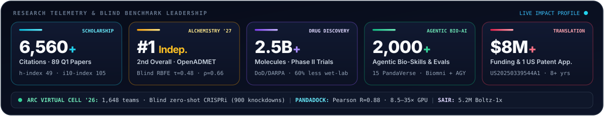
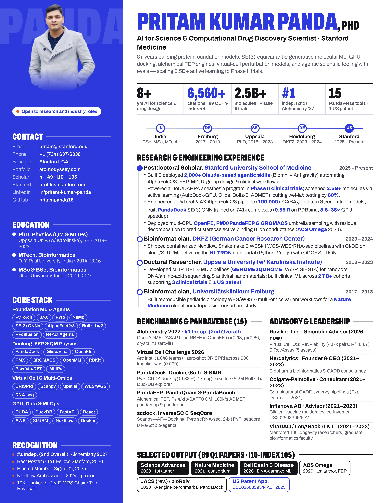
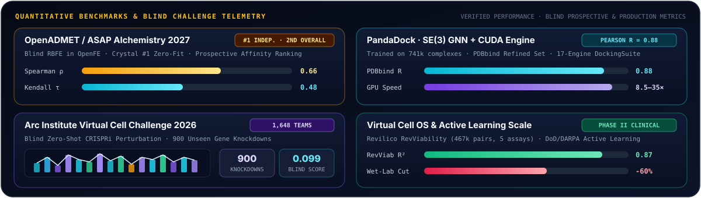
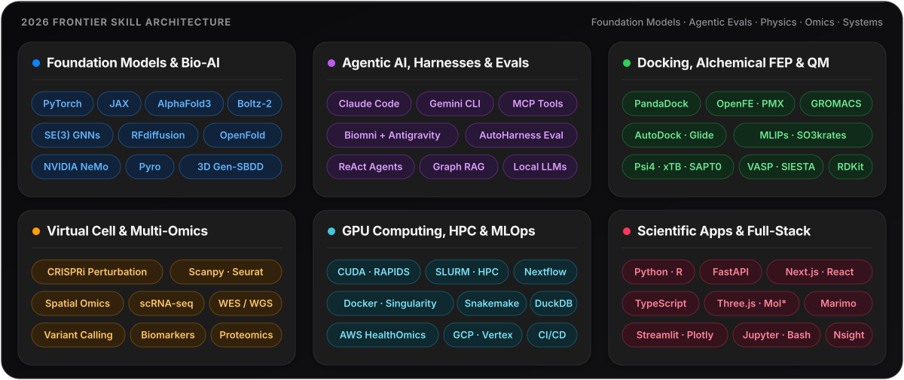
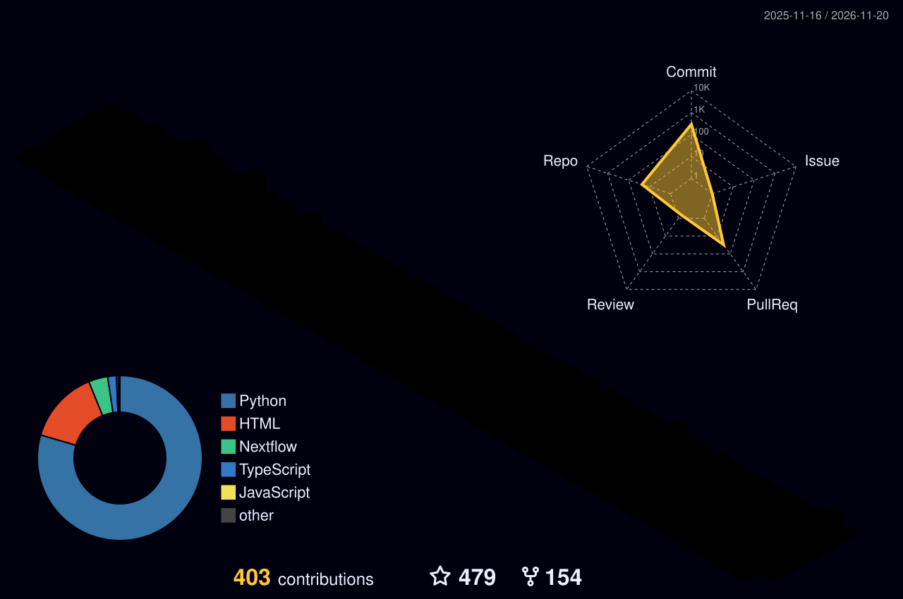
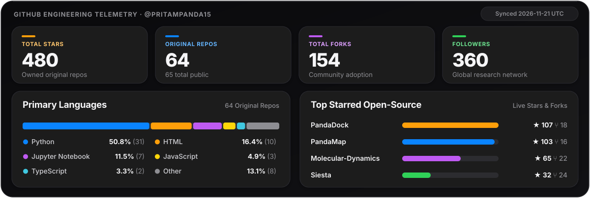

<!-- ═══════════════════ ANIMATED MOLECULAR HERO BANNER (DARK + LIGHT) ═══════════════════ -->
<a href="https://www.atomodyssey.com">
  <picture>
    <source media="(prefers-color-scheme: dark)" srcset="assets/hero-banner.svg">
    <source media="(prefers-color-scheme: light)" srcset="assets/hero-banner-light.svg">
    
  </picture>
</a>

 

<!-- ═══════════════════ KINETIC TYPING TELEMETRY (APPLE ADAPTIVE) ═══════════════════ -->
<a href="https://profiles.stanford.edu/pritam-panda">
  <picture>
    <source media="(prefers-color-scheme: dark)" srcset="https://readme-typing-svg.demolab.com?font=Inter&weight=600&size=21&duration=2600&pause=950&color=0A84FF&center=true&vCenter=true&width=960&lines=Postdoctoral+Scholar+%40+Stanford+Medicine+%E2%80%A2+AI+for+Molecular+Discovery;Protein+Foundation+Models+%28AF3+%2F+Boltz-2%29+%E2%80%A2+SE%283%29+GNNs+%E2%80%A2+Alchemical+FEP;%231+Independent+%282nd+Overall%29+%E2%80%A2+OpenADMET%2FASAP+Alchemistry+2027+Blind+Challenge;2%2C000%2B+Agentic+Bio-AI+Skills+%28Biomni+%2B+Antigravity%29+%E2%80%A2+AutoHarness+Eval+Loops;Scaled+Active+Learning+Across+2.5B%2B+Molecules+%E2%86%92+Phase+II+Clinical+Trials">
    <source media="(prefers-color-scheme: light)" srcset="https://readme-typing-svg.demolab.com?font=Inter&weight=600&size=21&duration=2600&pause=950&color=0071E3&center=true&vCenter=true&width=960&lines=Postdoctoral+Scholar+%40+Stanford+Medicine+%E2%80%A2+AI+for+Molecular+Discovery;Protein+Foundation+Models+%28AF3+%2F+Boltz-2%29+%E2%80%A2+SE%283%29+GNNs+%E2%80%A2+Alchemical+FEP;%231+Independent+%282nd+Overall%29+%E2%80%A2+OpenADMET%2FASAP+Alchemistry+2027+Blind+Challenge;2%2C000%2B+Agentic+Bio-AI+Skills+%28Biomni+%2B+Antigravity%29+%E2%80%A2+AutoHarness+Eval+Loops;Scaled+Active+Learning+Across+2.5B%2B+Molecules+%E2%86%92+Phase+II+Clinical+Trials">
    
  </picture>
</a>

<!-- ═══════════════════ PRIMARY ACTION & SOCIAL PILL BAR ═══════════════════ -->

  
  
  
  
  
  
  
  

<!-- ═══════════════════ LIVE GITHUB COUNTERS ═══════════════════ -->

  
  
  
  
  

 

<!-- ═══════════════════ ANIMATED IMPACT & BENCHMARK BENTO (DARK + LIGHT) ═══════════════════ -->
<picture>
  <source media="(prefers-color-scheme: dark)" srcset="assets/impact-bento.svg">
  <source media="(prefers-color-scheme: light)" srcset="assets/impact-bento-light.svg">
  
</picture>

 

## About Me

I’m an **AI for Science & Computational Drug Discovery Scientist** at **Stanford University School of Medicine** with **8+ years** building scalable scientific machine learning systems across protein foundation models, **SE(3)-equivariant & generative molecular ML**, GPU-accelerated docking, **alchemical free-energy (FEP)** engines, **virtual-cell CRISPRi perturbation models**, and **self-evaluating agentic bio-AI harnesses**.

- **Translational Scale:** Scaled closed-loop active learning across **2.5B+ molecules** (AutoDock-GPU, Glide, Boltz-2, ADMET) to advance a **DoD/DARPA** therapeutic program into **Phase II clinical trials**, cutting wet-lab testing by **60%** and helping secure **$8M+** in research funding.
- **Blind Benchmark Leadership:** Ranked **#1 independent participant (2nd overall)** in the **OpenADMET/ASAP Alchemistry 2027 Blind RBFE Challenge** (OpenFE, τ = 0.48, ρ = 0.66) and competed across **1,648 teams** in the **Arc Institute Virtual Cell Challenge 2026** (blind zero-shot CRISPRi across 900 knockdowns).
- **Agentic Scientific Engineering:** Built & deployed **2,000+ Claude/Gemini agentic bio-skills** (**Biomni + Antigravity**) automating AlphaFold2/3, FEP, MD, R-group design, and clinical workflows — backed by **AutoHarness** automated regression eval loops.
- **Scholarship & Open Source:** Creator of **15 open-source tools (PandaVerse)**; author of **89 Q1 papers** (*Science Advances*, *Nature Medicine*, *Cell Death & Disease*, *ACS Omega*, *Leukemia*; **6,560+ citations**, **h-index 49**, **i10-index 105**) and co-inventor on **1 U.S. patent application** (`US20250339544A1`).

| `IN` India | `DE` Freiburg | `SE` Uppsala & Karolinska | `DE` DKFZ Heidelberg | `US` Stanford Medicine |
| :---: | :---: | :---: | :---: | :---: |
| **BSc · MSc · MTech** Bioinformatics (2009–2016) | **NGS Data Analyst** *Nature Medicine* MDS (2017–2018) | **PhD Physics & Clinical ML** GENOME2QUNOME · Patent (2018–2023) | **HPC Bioinformatician** HI-TRON Portal · Nextflow (2023–2024) | **Postdoctoral Scholar** AI Drug Discovery & Bio-Agents (2025–Now) |

<b>Open One-Page Visual Research Dossier (Stanford · Benchmarks · Career Timeline)</b>

 

  

  <picture>
    <source media="(prefers-color-scheme: dark)" srcset="assets/divider-wave.svg">
    <source media="(prefers-color-scheme: light)" srcset="assets/divider-wave-light.svg">
    
  </picture>

## Quantitative Benchmarks & Blind Challenges

  <picture>
    <source media="(prefers-color-scheme: dark)" srcset="assets/benchmarks-card.svg">
    <source media="(prefers-color-scheme: light)" srcset="assets/benchmarks-card-light.svg">
    
  </picture>

  <picture>
    <source media="(prefers-color-scheme: dark)" srcset="assets/divider-wave.svg">
    <source media="(prefers-color-scheme: light)" srcset="assets/divider-wave-light.svg">
    
  </picture>

## Closed-Loop Research-to-Therapeutic Architecture

  <picture>
    <source media="(prefers-color-scheme: dark)" srcset="assets/pipeline-motion.svg">
    <source media="(prefers-color-scheme: light)" srcset="assets/pipeline-motion-light.svg">
    
  </picture>

  <picture>
    <source media="(prefers-color-scheme: dark)" srcset="assets/divider-wave.svg">
    <source media="(prefers-color-scheme: light)" srcset="assets/divider-wave-light.svg">
    
  </picture>

## Flagship Open-Source Ecosystem · PandaVerse & Agentic Bio-AI

<table>
  <tr>
    <td width="50%" valign="top">
      <h3>
        <a href="https://github.com/pritampanda15/PandaDock">
          &nbsp;&nbsp;PandaDock
        </a>
      </h3>
      
<b>GPU-Accelerated Physics + SE(3) GNN Molecular Docking</b> — flexible-ligand docking with an SE(3)-equivariant GNN trained on 741k complexes, rich interaction reports, and desktop/GUI support.

      
<b>Signal:</b> Pearson <code>R = 0.88</code> on PDBbind refined set · <code>8.5–35×</code> CUDA speedup.

      
      
      
    </td>
    <td width="50%" valign="top">
      <h3>
        <a href="https://github.com/pritampanda15/PandaMap">
          &nbsp;&nbsp;PandaMap
        </a>
      </h3>
      
<b>Protein–Ligand Interaction Mapper</b> — automated detection, publication-grade 2D/3D visualization, and empirical binding affinity estimation for structural biology and CADD workflows.

      
<b>Signal:</b> Zero-friction structural interaction profiling adopted across drug design pipelines.

      
      
      
    </td>
  </tr>
  <tr>
    <td width="50%" valign="top">
      <h3>
        <a href="https://github.com/pritampanda15/autoharness">
          &nbsp;&nbsp;AutoHarness
        </a>
      </h3>
      
<b>Autonomous Agent Harness Evaluation Loop</b> — continuously evaluates system prompts, tools, context, and model settings; grades every trial, diffs against last known-good runs, and blocks regressions.

      
<b>Signal:</b> Built for reliable, eval-driven scientific and engineering AI agents.

      
      
      
    </td>
    <td width="50%" valign="top">
      <h3>
        
      </h3>
      
<b>Macromolecular Interface Mapper</b> — comprehensive profiling and visualization of protein–protein, protein–nucleic acid, and antigen–antibody binding interfaces.

      
<b>Signal:</b> Extends PandaMap precision to biologics, antibodies, and nucleic acid complexes.

      
      
      
    </td>
  </tr>
  <tr>
    <td width="50%" valign="top">
      <h3>
        <a href="https://github.com/pritampanda15/Seqcore">
          &nbsp;&nbsp;Seqcore
        </a>
      </h3>
      
<b>Unified High-Performance Bio-Sequence Library</b> — vectorized 2-bit/ordinal Python toolkit unifying genomics, proteomics, structural biology, and drug design.

      
<b>Signal:</b> Up to <code>35.8×</code> faster GC &amp; <code>32.3×</code> faster translation vs. Biopython on 100k sequences.

      
      
      
    </td>
    <td width="50%" valign="top">
      <h3><a href="https://github.com/pritampanda15/AtomicDockExplain">AtomicDockExplain</a> &amp; <a href="https://github.com/pritampanda15/sair-explorer">SAIR Explorer</a></h3>
      
<b>Explainable Docking + 5.2M Boltz-1x DuckDB Explorer</b> — post-docking atom-level energy attribution paired with fast protein/IC50/3D structure exploration over the SandboxAQ SAIR dataset.

      
<b>Signal:</b> Bridges deep-learning structure predictions with interpretable medicinal chemistry.

      
      
      
    </td>
  </tr>
</table>

<b>Explore More Open-Source Systems (AI-RAG · Molecular Dynamics · DFT · nf-core Pipelines)</b>

 

| Repository | Domain | Highlights |
| :--- | :--- | :--- |
| [**ADMET GNN-RAG**](https://github.com/pritampanda15/ADMET-Prediction-System-Graph-Neural-Networks-with-RAG) | Molecular AI + RAG | Graph Neural Network ADMET predictor paired with LLM mechanistic drug-likeness explanations |
| [**Drug Repurposing R-GCN-RAG**](https://github.com/pritampanda15/Drug-Repurposing-Intelligence-System) | Knowledge Graphs | Relational GCN + RAG over heterogeneous biomedical graphs for explainable repurposing |
| [**Oncology DL-RAG**](https://github.com/pritampanda15/Oncology-Drug-Response-Prediction-System_DL-RAG) | Precision Oncology | Multi-omics deep learning drug-response predictor with RAG clinical decision explanations |
| [**Literature Intelligence**](https://github.com/pritampanda15/Literature-Intelligence) | Bio-NLP / BioBERT | Automated PubMed & bioRxiv indexing, BioBERT retrieval, and LLM synthesis for drug targets |
| [**nf-core / moleculardocking**](https://github.com/pritampanda15/moleculardocking) | Nextflow Pipeline | High-throughput containerized virtual screening pipeline with modern receptor/ligand prep |
| [**Molecular-Dynamics (GROMACS)**](https://github.com/pritampanda15/Molecular-Dynamics) | MD Simulation | 64★ self-explained GROMACS simulation workflows, topologies, and analysis protocols |
| [**SIESTA DFT Protocols**](https://github.com/pritampanda15/Siesta) | Quantum Physics | 32★ FDF workflows for structural relaxation, PDOS, and Denchar ab-initio calculations |
| [**SSN — Sigil Structured Notation**](https://github.com/pritampanda15/SSN-Sigil-Structured-Notation) | LLM Efficiency | Token-efficient notation cutting LLM context token overhead by 60–75% vs. JSON |

   
  

  <picture>
    <source media="(prefers-color-scheme: dark)" srcset="assets/divider-wave.svg">
    <source media="(prefers-color-scheme: light)" srcset="assets/divider-wave-light.svg">
    
  </picture>

## 2026 Frontier Skill Matrix & Technical Ecosystem

  <picture>
    <source media="(prefers-color-scheme: dark)" srcset="assets/skills-architecture.svg">
    <source media="(prefers-color-scheme: light)" srcset="assets/skills-architecture-light.svg">
    
  </picture>

 

  <picture>
    <source media="(prefers-color-scheme: dark)" srcset="assets/divider-wave.svg">
    <source media="(prefers-color-scheme: light)" srcset="assets/divider-wave-light.svg">
    
  </picture>

## Selected Scholarship, IP & Advisory

<table>
  <tr>
    <td width="50%" valign="top">
      <h3>Flagship Publications &amp; Patent</h3>
      <ul>
        <li><b>Science Advances</b> (2020 · 1st Author, 150+ cites) — Structure-Based Drug Designing &amp; Immunoinformatics for SARS-CoV-2</li>
        <li><b>Nature Medicine</b> (2021 · Consortium, 150+ cites) — Clinical Evolution &amp; Genetic Landscape of Clonal Hematopoiesis in SAMD9/9L</li>
        <li><b>Cell Death &amp; Disease</b> (2026) — DNA-Damage Machine Learning &amp; Therapeutic Modeling</li>
        <li><b>ACS Omega</b> (2026 · 1st Author) — Multi-GPU Alchemical FEP &amp; Umbrella Sampling for Stereoselective Binding</li>
        <li><b>Leukemia</b> (2019) &amp; <b>Experimental Dermatology</b> (2024) — Oncology &amp; Combinatorial Synergy CADD</li>
        <li><b>U.S. Patent Application</b> — <a href="https://patentscope.wipo.int/search/en/detail.jsf?docId=WO2023217787"><code>US20250339544A1</code> / <code>WO2023217787</code></a> (Novel Antiviral Therapy Candidate)</li>
      </ul>
    </td>
    <td width="50%" valign="top">
      <h3>Advisory, Leadership &amp; Recognition</h3>
      <ul>
        <li><b>Revilico Inc.</b> (2025–Present) — Scientific Advisor · Virtual Cell OS (RevViability 467k pairs, R²=0.87 &amp; RevAssay)</li>
        <li><b>Stanford Medicine</b> (2026) — Best Poster &amp; Technology &amp; Translation (TaT) Fellow</li>
        <li><b>Nextflow Ambassador</b> (2024–Present) &amp; <b>Sigma Xi</b> Elected Member (2025)</li>
        <li><b>Colgate-Palmolive</b> &amp; <b>Inflanova AB</b> — Industry CADD &amp; Vaccine Multi-Omics Consultant</li>
        <li><b>Nerdalytics</b> — Former Founder &amp; CEO (Biopharma Bioinformatics Consultancy)</li>
        <li><b>Community &amp; Mentorship</b> — Mentored 160+ researchers (VitaDAO / LongHack), 2× E-MRS Chair, 15K+ LinkedIn</li>
      </ul>
    </td>
  </tr>
</table>

<b>Latest Indexed Publications &amp; Preprints (Auto-Synced Weekly from ORCID)</b>

 

<!-- ORCID:START -->
| Year | Publication | Venue |
| :---: | :--- | :--- |
| `2026` | [**Alchemical Free Energy Perturbation Predicts Relative Binding Affinities of Propofol Analogs and Etomidate Stereoisomers at the GABAAR**](https://doi.org/10.1021/acsomega.6c08745) | *ACS Omega* |
| `2026` | [**PandaDock: An Open-Source Molecular Docking Platform with Flexible-Ligand Search and Equivariant Neural Scoring**](https://doi.org/10.64898/2026.08.19.745667) | *Preprint / Journal* |
| `2026` | [**Structural Context Determines Docking Engine Performance: A Family-Stratified Benchmark of Six Engines**](https://doi.org/10.64898/2026.08.11.744016) | *Preprint / Journal* |
| `2026` | [**PandaMap: A Python Package for Comprehensive Visualization of Protein–Ligand Interaction Networks**](https://doi.org/10.64898/2026.08.06.743421) | *Preprint / Journal* |
| `2026` | [**An ATM-AMPK-Wip1 feedback loop governing DNA-damage signaling and tumor stress responses.**](https://doi.org/10.1038/s41419-026-08599-z) | *Cell death & disease* |
| `2024` | [**Molecular insights to in vitro biocompatibility of endodontic Pulpotec with macrophages determined by oxidative stress and apoptosis**](https://doi.org/10.1016/j.biopha.2024.116921) | *BIOMEDICINE & PHARMACOTHERAPY* |
<!-- ORCID:END -->

  <picture>
    <source media="(prefers-color-scheme: dark)" srcset="assets/divider-wave.svg">
    <source media="(prefers-color-scheme: light)" srcset="assets/divider-wave-light.svg">
    
  </picture>

## Latest Tutorials & Walkthroughs · Omixium

<!-- YOUTUBE:START -->
<table>
  <tr>
    <td width="25%" align="center" valign="top">
       
      <a href="https://www.youtube.com/watch?v=sulPb1lpuXE"><b>Seqcore: High-performance biological sequence analysis librar…</b></a> 
      2026-08-27
    </td>
    <td width="25%" align="center" valign="top">
       
      <a href="https://www.youtube.com/watch?v=QtHLpzLey7A"><b>Nanoparticle Docking using AutoDock4 | Case Study: Gold Nanop…</b></a> 
      2026-01-29
    </td>
    <td width="25%" align="center" valign="top">
       
      <a href="https://www.youtube.com/watch?v=bTBwDPKn2uE"><b>Please visit my GitHub https://github.com/pritampanda15/AI-gl…</b></a> 
      2025-12-28
    </td>
    <td width="25%" align="center" valign="top">
       
      <a href="https://www.youtube.com/watch?v=tVafC_jy8yA"><b>AI / LLM / RAG / ML in healthcare coming soon</b></a> 
      2025-12-06
    </td>
  </tr>
</table>
<!-- YOUTUBE:END -->

  <picture>
    <source media="(prefers-color-scheme: dark)" srcset="assets/divider-wave.svg">
    <source media="(prefers-color-scheme: light)" srcset="assets/divider-wave-light.svg">
    
  </picture>

## Live GitHub Telemetry & 3D Motion Analytics

<!-- 100% Uptime Actions-Generated Visuals (Never affected by external Vercel rate limits) -->
<picture>
  <source media="(prefers-color-scheme: dark)" srcset="https://raw.githubusercontent.com/pritampanda15/pritampanda15/gh-pages/github-contribution-grid-snake-dark.svg">
  <source media="(prefers-color-scheme: light)" srcset="https://raw.githubusercontent.com/pritampanda15/pritampanda15/gh-pages/github-contribution-grid-snake.svg">
  
</picture>

  

<!-- 3D Isometric Contribution Landscape (auto-updated daily via .github/workflows/profile-3d.yml) -->
<picture>
  <source media="(prefers-color-scheme: dark)" srcset="profile-3d-contrib/profile-night-rainbow.svg">
  <source media="(prefers-color-scheme: light)" srcset="profile-3d-contrib/profile-season-animate.svg">
  
</picture>

  

<!-- Self-Hosted Live GitHub Telemetry Card (auto-updated daily via .github/workflows/auto-sync.yml) -->
<picture>
  <source media="(prefers-color-scheme: dark)" srcset="assets/github-telemetry.svg">
  <source media="(prefers-color-scheme: light)" srcset="assets/github-telemetry-light.svg">
  
</picture>

<b>Live Streak, Languages &amp; Commit Velocity Graphs (External Real-Time Endpoints)</b>

 

<picture>
  <source media="(prefers-color-scheme: dark)" srcset="https://github-readme-stats.vercel.app/api?username=pritampanda15&show_icons=true&rank_icon=percentile&include_all_commits=true&theme=tokyonight&hide_border=true&bg_color=0B1224&title_color=22D3EE&icon_color=A78BFA&text_color=E2E8F0">
  <source media="(prefers-color-scheme: light)" srcset="https://github-readme-stats.vercel.app/api?username=pritampanda15&show_icons=true&rank_icon=percentile&include_all_commits=true&theme=default&hide_border=true">
  
</picture>
<picture>
  <source media="(prefers-color-scheme: dark)" srcset="https://github-readme-stats.vercel.app/api/top-langs/?username=pritampanda15&layout=compact&langs_count=8&theme=tokyonight&hide_border=true&bg_color=0B1224&title_color=22D3EE&text_color=E2E8F0">
  <source media="(prefers-color-scheme: light)" srcset="https://github-readme-stats.vercel.app/api/top-langs/?username=pritampanda15&layout=compact&langs_count=8&theme=default&hide_border=true">
  
</picture>

 

<picture>
  <source media="(prefers-color-scheme: dark)" srcset="https://streak-stats.demolab.com?user=pritampanda15&theme=tokyonight&hide_border=true&background=0B1224&ring=22D3EE&fire=F59E0B&currStreakLabel=A78BFA">
  <source media="(prefers-color-scheme: light)" srcset="https://streak-stats.demolab.com?user=pritampanda15&theme=default&hide_border=true">
  
</picture>

 

  <picture>
    <source media="(prefers-color-scheme: dark)" srcset="assets/divider-wave.svg">
    <source media="(prefers-color-scheme: light)" srcset="assets/divider-wave-light.svg">
    
  </picture>

## Let’s Build Something Consequential

I’m actively open to **senior research scientist / AI for science roles, translational collaborations, scientific advisory, and open-source partnerships** across:

- **Protein & Molecular Foundation Models** (AlphaFold3, Boltz-2, SE(3) GNNs, 3D Generative SBDD)
- **Physics-Aware Drug Discovery** (GPU Docking, Alchemical FEP, MLIPs, Active Learning)
- **Virtual Cell & Multi-Omics Systems** (CRISPRi Perturbation, Single-Cell & Spatial Biology)
- **Agentic Bio-AI & Scientific Evals** (Biomni, Antigravity Skills, AutoHarness, Graph RAG)

  

    
    
    
    
  

   

  <!-- ═══════════════════ ANIMATED BIOLUMINESCENT WAVE FOOTER (DARK + LIGHT) ═══════════════════ -->
  <picture>
    <source media="(prefers-color-scheme: dark)" srcset="assets/footer-wave.svg">
    <source media="(prefers-color-scheme: light)" srcset="assets/footer-wave-light.svg">
    
  </picture>

